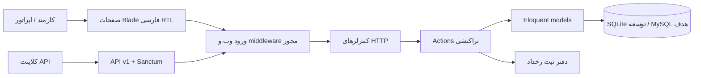

# معماری و مرز نسخه

## وضعیت

این پوشه ریشهٔ برنامهٔ مستقل Laravel است؛ فایل‌های PHP قدیمی در ریشهٔ repository دست‌نخورده‌اند. محصول فعلی شامل چند جریان اجرایی احراز هویت، مشتری/KYC، قرارداد/اعتبار و دریافت دستی قسط است، اما جایگزین سامانهٔ قدیمی یا آمادهٔ عملیات مالی نیست. نقشهٔ شکاف، تصمیم‌های فنی و اقلام باز در اسناد همین پوشه ثبت شده‌اند.

## لایه‌ها

- **رابط کاربری:** Blade، Tailwind CSS 4، Vite؛ `lang=fa-IR`, `dir=rtl`, برچسب‌های فارسی، قالب‌بندی رقم فارسی و تاریخ جلالی.
- **احراز هویت:** نشست Laravel برای وب؛ Laravel Sanctum personal access tokens برای API. هیچ ثبت‌نام عمومی یا مدیر پیش‌فرضی وجود ندارد.
- **مجوزدهی:** role/permission سادهٔ داخلی. کاربران و مشتریان شعبه‌دار به شعبه محدود می‌شوند؛ مجوز `customers.view_all` این محدودیت را برای خواندن کنار می‌زند. دسترسی نوشتن نیز باید در policy/action کنترل شود.
- **منطق کاربرد:** عملیات حساس در Action مجزا قرار دارند. تغییر سقف اعتبار در تراکنش، با `lockForUpdate`, شناسهٔ idempotency، قید پایگاه داده و رخداد audit انجام می‌شود.
- **دادهٔ مالی:** مبلغ‌ها عدد صحیح تومان در ستون‌های `*_toman` و واحد `TMN` هستند. float برای محاسبهٔ پول مجاز نیست. هیچ سیاست تبدیل/گرد کردن یا جریمهٔ نسخهٔ قدیمی را تا زمان تطبیق منتقل‌شده فرض نکنید.
- **دادهٔ حساس:** شناسهٔ ملی رمزگذاری‌شده با encrypted cast نگهداری می‌شود؛ hash آن برای یکتایی جداگانه ثبت می‌شود. چرخش کلید، backup و بازیابی باید در استقرار طراحی شود.
- **مشاهده‌پذیری:** شناسهٔ درخواست به پاسخ HTTP افزوده می‌شود؛ audit فعلی ثبت رخدادهای کاربردی است، نه سامانهٔ کامل log/metrics/tracing.

## قابلیت‌های پیاده‌شده در این برش

1. ورود/خروج کارکنان، محدودسازی تلاش ورود و ساخت مدیر اولیه از CLI.
2. نقش و مجوز، نمای داشبورد و دامنهٔ شعبه برای مشتری.
3. ایجاد/نمایش مشتری و ثبت/بررسی KYC.
4. تغییر سقف اعتبار به شکل ثبت ledger و audit.
5. ثبت idempotent درخواست پرداخت در وضعیت pending و دریافت دستی قسط پس از quote و بررسی تخصیص.
6. اصلاح داخلی و reason-based پرداخت قسطی موفق، با ردیف reversal و بدون انتقال بانکی.
7. API JSON نسخهٔ ۱ برای جریان‌های بالا و API token.

چرخهٔ محدود پیش‌نویس → ارسال و رزرو → تأیید → فعال‌سازی برای قرارداد وجود دارد و دریافت دستی قسط با quote نسخه‌دار، تخصیص مالی و اصلاح داخلی انجام می‌شود. درگاه، رسید بارگذاری‌شده و بازبینی آن، برگشت بانکی، هزینه/ارجاع حقوقی، reconciliation و تسویهٔ پذیرنده هنوز اجرا نشده‌اند. جزئیات وضعیت واقعی هر حوزه در PRODUCTION-GAP-MATRIX.md آمده است.

## طرح داده

نمودار و قیود در [DATABASE.md](DATABASE.md) آمده‌اند. migrationها روی SQLite و MariaDB 10.4.32 جداگانه اجرا شده‌اند؛ رفتار MySQL 8 و موتور production هنوز تأیید نشده است.

## تصمیم‌ها

تصمیم‌های قطعی و گزینه‌های باز در [تصمیم معماری](adr/0001-laravel-foundation.md) ثبت شده‌اند. نقشهٔ دامنهٔ قدیمی در [FEATURE-MAP](FEATURE-MAP.md) و نگاشت ۷۳ جدول تعریف‌شده در فایل نصب فعلی در [LEGACY-MAPPING](LEGACY-MAPPING.md) است.
