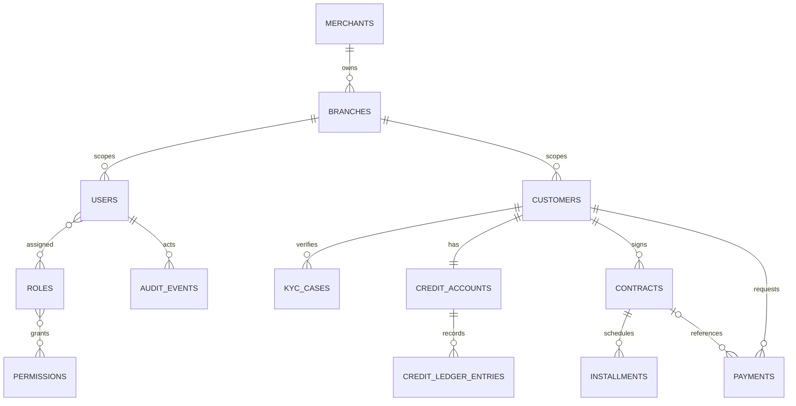

# مدل داده

## ERD پایه

نام ERD جمع انگلیسی است؛ migrationهای Laravel مرجع واقعی نام/nullable/قید هستند.

## جدول‌های پایه

| جدول | هدف | قیود مهم |
|---|---|---|
| `merchants`, `branches` | tenant تجاری و شعبه | کد شعبه یکتا؛ merchant اختیاری در پایه |
| `users`, `roles`, `permissions`, `role_user`, `permission_role` | کاربران و RBAC | ایمیل Laravel یکتا؛ مجوزها بر اساس slug |
| `customers` | نمایهٔ مشتری | موبایل یکتا؛ hash کد ملی یکتا؛ شعبه و سازنده؛ وضعیت و تاریخ تولد |
| `kyc_cases` | چرخهٔ پایهٔ بررسی KYC | مشتری با `restrictOnDelete`; وضعیت و زمان ارسال/بررسی |
| `credit_accounts` | سقف، مصرف و رزرو | یک حساب برای هر مشتری؛ همهٔ مبالغ integer تومان |
| `credit_ledger_entries` | تاریخچهٔ تغییر سقف | `request_id` یکتا؛ حد قبل/بعد، actor و دلیل؛ append-only در مسیر برنامه |
| `contracts`, `installments` | حداقل schema قرارداد/قسط | شماره قرارداد یکتا؛ شماره قسط یکتا در قرارداد؛ اعداد صحیح تومان |
| `payments` | درخواست پرداخت | کلید idempotency یکتا؛ مبلغ تومان؛ وضعیت و تاریخ تکمیل |
| `audit_events` | رخدادهای کاربردی | actor/request/subject/metadata؛ برای تغییرات حساس پایه |
| `personal_access_tokens` | API tokenهای Sanctum | عمر token از config؛ قابلیت `proma-api` |

## قواعد داده

- مبلغ را در ستون‌های `*_toman` به صورت عدد صحیح نگه دارید؛ برای overflow و کران‌های business rule پیش از افزودن مسیر جدید بررسی کنید. پشتیبانی `bcmath` برای مقایسه/محاسبات رشته‌ای استفاده شده است.
- شناسهٔ ملی خام در ستون رمزگذاری‌شده ذخیره می‌شود و برای یکتایی از HMAC/hash جدا استفاده می‌شود؛ دسترسی خواندن یا نمایش آن باید حداقلی بماند.
- ledger و audit نباید از رابط عمومی ویرایش/حذف شوند. اصلاحات آینده باید رخداد اصلاحی معکوس و actor/reason داشته باشند.
- کلیدهای خارجی در migration محدودیت حذف مشتری/قرارداد مالی را اعمال می‌کنند؛ رفتار آرشیو و retention نهایی باید با الزام حقوقی هم‌راستا شود.
- `credit_accounts.used_toman` و `reserved_toman` فعلاً فقط ستون‌های پایه‌اند؛ چرخهٔ رزرو/مصرف/آزادسازی پیاده نشده است.
- مبالغ و تاریخ‌های legacy هنوز تبدیل نشده‌اند. واحد ریال/تومان، timezone، تاریخ شمسی/میلادی و rounding باید برای هر منبع جداگانه تأیید شوند.

## سازگاری موتور پایگاه داده

migrationها با SQLite توسعه اجرا شده‌اند. MySQL/MariaDB، isolation level، deadlock retry، قفل ردیف، collation فارسی، unique nullable و JSON در موتور production هنوز integration-test نشده‌اند. پیش از انتشار نسخهٔ واقعی، همان migrationها و آزمون‌های concurrency را روی نسخهٔ دقیق موتور هدف اجرا کنید؛ موفقیت SQLite اثبات رفتار مالی MySQL نیست.
